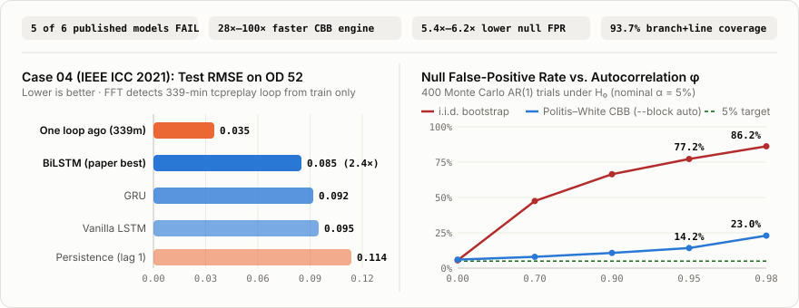
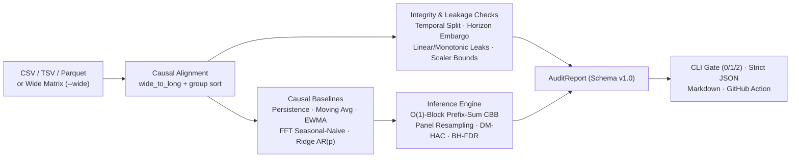

# predictive-audit

[](https://github.com/GIlbertoRCP/predictive_audit/actions/workflows/ci.yml)
[](pyproject.toml)
[](pyproject.toml)
[](LICENSE)
[](src/predictive_audit/py.typed)

**Does your forecasting model actually beat "the next step looks like this one"?**

`predictive-audit` is a fast, statistically rigorous validation engine and CI gate for time-series forecasting. It tests any forecasting result against causal baselines, panel-aware Circular Block Bootstrap CIs (with Politis–White adaptive block selection), Diebold–Mariano HAC tests, and automated temporal/feature/scaler leakage checks—and ships six end-to-end empirical audits across network traffic and cloud VM workloads.

**Read the findings:** [Empirical Write-up](docs/WRITEUP.md) · [Interactive Explorer](https://gilbertorcp.github.io/predictive_audit/) ([`site/`](site/)) · [Architecture & Design](docs/DESIGN.md) · [Benchmarks](BENCHMARKS.md)



---

## Architecture



### What it checks

| Check | What it catches |
|---|---|
| **Beats trivial baselines** | Model vs. persistence, moving average, seasonal-naive (manual or FFT-estimated), EWMA, Ridge AR(p), and climatology on the exact same rows—scored with **panel-aware Circular Block Bootstrap** 95% CIs, **Diebold–Mariano HAC** p-values, MASE, and skill scores. |
| **Reported score** | A published headline number that a trivial baseline already matches or beats on the same data. |
| **Label memory** | Targets so autocorrelated that any model posts a high raw score; only the margin over persistence matters. |
| **Temporal split & embargo** | Shuffled/interleaved splits, multi-step **horizon embargo** overlap (`test_start - train_end < horizon`), and duplicate timestamps. |
| **Feature & scaler leakage** | Linear (`|r| >= 0.999`) and nonlinear monotonic (`|ρ| >= 0.999`) copies of future targets `y[t+1..t+h]`, plus global `[0, 1]` min-max scaling fit across train+test. |

---

## Empirical Case Studies (5 of 6 Fail)

| # | Result audited | Claimed | Verdict | Key finding |
|---|---|---|---|---|
| 01 | [Predictive_Activation v0](cases/01_predictive_activation_lstm/) (course project) | F1 ≈ 0.99 | **FAIL** | Shuffled split leaks; under a chronological split the model *loses* to a 3-step moving average (F1 0.984 vs. 0.987). |
| 02 | [xiaochus/TrafficFlowPrediction](cases/02_xiaochus_pems/) (681★, PeMS) | MAE 7.06–7.21, R² 0.94 | **holds up** (WARN) | Audited with published Keras 2.1 weights via pure-NumPy forward pass (reproduced to 2 decimals). Beats 3-step MA by 8–10% MAE; R² is mostly autocorrelation (persistence alone: 0.92). |
| 03 | [THU-INSC-NAD/Traffic-Matrix-Prediction](cases/03_thu_traffic_matrix/) (ISCC 2019) | Per-OD LSTM on Abilene, GÉANT, CERNET | **FAIL** | All 785 OD models retrained via batched PyTorch `StackedLSTM` (4.68× faster, `< 1.8e-7` drift): LSTM is 11–21% *worse* than persistence on every network and beats baselines on only 14% of active ODs. Linear AR(10) beats LSTM everywhere. |
| 04 | [SDN-TMprediction](cases/04_sdn_tm_prediction/) (IEEE ICC 2021) | LSTM/BiLSTM/GRU on Mininet testbed | **FAIL** (9 of 13) | `tcpreplay` pcaps loop (339-min FFT peak, r = 0.89 vs. lag-1 r = 0.07). "One replay loop ago" beats RNNs on 9 of 13 ODs and has 2.4× lower RMSE on the showcased flow (0.035 vs. 0.085). |
| 05 | [Annongkhanh/Traffic-matrix-prediction](cases/05_sdn_tm_lstm_geant_zamren/) | MSE 0.026 (GÉANT), 0.041 (testbed) | **FAIL** | Reported error is higher than persistence on both datasets (~2.5× higher MSE on GÉANT: 0.0260 vs. 0.0102). |
| 06 | [Azure VM CPU Utilization](cases/06_azure_vm_cpu/) (Microsoft Azure cloud trace) | LSTM / GRU / IndRNN (1.12–1.25% MAPE) | **FAIL** | Persistence alone hits R² 0.9978 & 1.11% MAPE (beating LSTM/IndRNN in scaled units); EWMA(3) beats IndRNN and causal Ridge AR(5) beats all 3 RNNs on raw RMSE & MAE. Also exposed `sqrt(MAE)` (130× underreport) and `np.corrcoef` bugs. |

More candidates tracked in [cases/SHORTLIST.md](cases/SHORTLIST.md).

---

## Performance & Statistical Calibration

Full tables and reproducible scripts are in [BENCHMARKS.md](BENCHMARKS.md):

- **Up to 100× faster bootstrap inference & 42% lower peak memory:** O(1)-per-block prefix-sum vectorization cuts 10k-row F1 audits from `2,676 ms → 26.7 ms` (**100.3×**) and 500k-row F1 audits from `7,789 ms → 281.2 ms` (**27.7×**, 1.78M rows/s, peak memory `106 → 61.9 MB`).
- **1M-cell traffic-matrix panels in < 0.7 s:** Vectorized `wide_to_long` reshapes 500 × 2,000 panels in **20.6 ms** (**9.7×** faster), and time-aligned panel auditing finishes in **675 ms**.
- **Verified Type I error control:** Monte Carlo calibration under $H_0$ shows i.i.d. bootstrapping suffers **47.5%–77.2%** false positives at $\phi \in [0.70, 0.95]$, while Politis–White adaptive Circular Block Bootstrapping (`--block auto`) scales block length automatically (`2 → 88`) and cuts false positives by **5.4×–6.2×**.

---

## Quickstart

### CLI (CSV, TSV, Parquet, Feather, or Wide Matrices)

```bash
uv sync
uv run predictive-audit data.csv \
    --target future_congestion --pred model_score \
    --group switch_id,port_no --time timestamp --split split \
    --features rx_mbps,latency_ms --metric f1 --reported 0.99
```

Audit a wide traffic matrix directly with a Ridge AR(5) baseline and TOML config:

```bash
uv run predictive-audit traffic_matrix.tsv \
    --wide --split split --task regression \
    --season auto --ar-lags 5 --ewma --format json --out report.json
```

#### Standalone binary (no Python needed)

The same CLI is also a single C++ executable. It reads CSV/TSV exactly as `pandas.read_csv` does, and its reports match the Python package's. It starts in about 5 ms; the Python CLI needs about 250 ms just to import.

```bash
make native   # builds build/native/predictive-audit
build/native/predictive-audit data.csv --target y_next --pred model --time t --split split --threads 8
```

Parquet and Feather need the Python package (pyarrow); the binary says so and exits with code 2.

### Python API (Single & Multi-Series Batch Audit with FDR)

```python
from predictive_audit import audit, batch_audit, report

# Single or pooled panel audit
r = audit(
    df, "future_congestion",
    pred="model_score", groups=["switch_id", "port_no"],
    time="timestamp", split="split",
    metric="f1", threshold="auto", ar_lags=5,
)
print(report.to_text(r))  # also to_markdown() / strict RFC 8259 to_json()

# Per-series audit across all OD pairs with Benjamini-Hochberg FDR q-values
batch = batch_audit(
    long_df, "y", group_col="od",
    task="regression", pred="lstm", time="step", split="split", season="auto",
)
print(batch.tally, "FDR-significant:", batch.n_fdr_significant)
```

### Gate Pull Requests with the Reusable GitHub Action

```yaml
- uses: GIlbertoRCP/predictive_audit@main
  with:
    data: artifacts/predictions.csv
    target: y_next
    pred: model_pred
    task: regression
    group: series_id
    time: timestamp
    split: split
    season: auto
    fail-on: fail
```

**Data convention:** one row per `(series, time step)`, where `--target` holds `y[t + horizon]` so baselines are rebuilt causally from lags $\ge h$. Only `--split == test` rows are scored. Exit codes: `0` (pass), `1` (audit verdict hit `--fail-on`), `2` (invalid input/config).

---

## Development & Explorer

```bash
make test        # 52 unit, Hypothesis property, CLI & statistical tests
make check       # ruff lint + mypy strict + pytest coverage (93.7%)
make bench       # regenerate latency & Monte Carlo calibration benchmarks
make site        # rebuild site/data/summary.json
python3 -m http.server 8791 --directory site
```

To reproduce individual case studies:

```bash
uv run python cases/01_predictive_activation_lstm/run.py
uv run --group cases python cases/02_xiaochus_pems/run.py   # fetches pinned third-party data/weights
```

## Limitations

- Baselines require ordered history per series; pre-windowed datasets must be unrolled first.
- Picking the best baseline on test rows is slightly conservative toward the model; inspect individual baseline rows in `AuditReport.table` when margins are close.
- Automatic block lengths scale with effective series length ($\sqrt{T_{\text{series}}}$); on extreme autocorrelation ($\phi \ge 0.95$), pass `--block` equal to the correlation length.
- Scaler-leakage detection flags global `[0, 1]` min-max bounds where test sets an extreme; it does not catch subtler leaks such as `StandardScaler` fit on train+test with identical moments.
