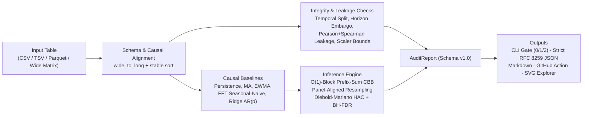

# Architecture & Design Decisions

This document explains the engineering and statistical trade-offs behind **predictive-audit**.

---

## 1. Pipeline Architecture

---

## 2. Core Engineering & Statistical Trade-offs

### Why Circular Block Bootstrap (CBB) + Panel-Aligned Resampling over i.i.d. Bootstrap
Standard i.i.d. bootstrapping treats every row as independent. On autocorrelated operational series ($\phi \in [0.70, 0.98]$), an i.i.d. 95% confidence interval produces **47%–86% false positives** under the null hypothesis (see [BENCHMARKS.md](../BENCHMARKS.md)).

Two subtle failure modes arise when extending block bootstrapping to multi-series panels:
1. **Cross-series boundary crossing & pooled block scaling:** Concatenating $G$ series of length $T$ and setting block length $B = \sqrt{G \cdot T}$ can make $B > T$, causing single blocks to span unrelated series. We instead detect time-aligned panels and resample contiguous blocks of *timestamps* across all series simultaneously (preserving cross-sectional correlation between co-moving links/ports) and scale $B$ by effective series length $T_{\text{eff}}$.
2. **Boundary edge-effect bias:** Non-circular moving-block bootstrap underweights the first and last $B - 1$ rows of every series. On Case 01's Mininet telemetry, 57% of baseline errors occur during traffic ramp-up in the first 11 steps of each port's run—causing non-circular within-group MBB to bias the bootstrap interval off-center from the point estimate. Switching to **within-group Circular Block Bootstrap** (Politis & Romano, 1992) wraps each group onto itself before resampling, guaranteeing exact uniform sampling probability $1/n$ per observation with zero cross-group contamination.

### Why O(1)-per-Block Prefix-Sum Vectorization
Naive block bootstrapping slices arrays of length $n$ inside a Python loop `n_boot` times and invokes `sklearn.metrics` per draw ($O(n_{\text{boot}} \cdot n)$). On 500k rows with 500 draws, F1 bootstrapping took **7.8 seconds**.

For every additive loss metric (`mae`, `rmse`, `r2`, `smape`, `accuracy`, `brier`) and confusion-matrix metric (`f1`, `mcc`, `balanced_accuracy`), we precompute cumulative prefix sums $P[k] = \sum_{i < k} s_i$ of per-observation sufficient statistics (e.g., `TP`, `FP`, `FN`, `TN` or squared errors). Evaluating any resampled block $[s, s+B)$ becomes a single $O(1)$ subtraction `P[s + B] - P[s]`, reducing total complexity to $O(n + n_{\text{boot}} \cdot \lceil n/B \rceil)$ while remaining numerically identical (`< 1e-10`) to explicit resampling—yielding up to **100× speedup** and **42% lower peak memory**.

### Why Diebold–Mariano HAC + Benjamini–Hochberg FDR
Block-bootstrap intervals are paired with a parametric **Diebold–Mariano test** using a Bartlett-kernel Newey–West long-run variance estimator and Harvey–Leybourne–Newbold finite-sample adjustment. When auditing hundreds of series independently (`batch_audit`, e.g., 785 OD pairs in Case 03), raw per-series p-values inflate family-wise false discoveries; `batch_audit()` therefore attaches **Benjamini–Hochberg FDR q-values** alongside per-group verdicts.

### Why Causal Target Alignment (`row t holds y[t + horizon]`)
Off-by-one indexing bugs are the single most common source of silent leakage in time-series evaluation code. Requiring `target[t] = y[t + h]` guarantees by construction that any baseline accessing lag $k \ge h$ only observes values available at decision time $t$. This also makes horizon embargo verification exact: if `first_test_step - last_train_step < horizon`, late training targets overlap the test window and trigger a `WARN`.

### Why Multi-Modal Leakage Detection (Linear, Monotonic, Embargo, Scaler)
Checking only Pearson $|r| \ge 0.999$ misses:
- **Nonlinear monotonic leaks** (e.g., `log(y[t+1])`, `exp(y[t+1])`): caught via Spearman rank correlation $|\rho| \ge 0.999$ compared against the feature's correlation with the *observed* value $y[t]$ (preventing false positives on smooth random walks).
- **Global `MinMaxScaler` leakage** (present in Cases 03, 04, and 05): detected when continuous columns lie strictly in $[0, 1]$ globally, yet an exact `0.0` or `1.0` boundary occurs only in `test` and never in `train`.
- **Horizon embargo violations & duplicate timestamps**: caught directly in vectorized $O(n)$ NumPy inside `_temporal_split`.

### Why Strict RFC 8259 JSON & Schema Versioning
Python's standard `json.dumps` defaults to `allow_nan=True`, emitting non-standard `NaN`/`Infinity` literals that break `jq`, JavaScript `JSON.parse`, and downstream CI tooling whenever metrics like `roc_auc` are undefined on single-class test slices. `report.to_json()` recursively normalizes non-finite floats to `null` with `allow_nan=False` and stamps every payload with `schema_version = "1.0"`.

### Why SHA-256 Pinned On-Demand Fetching & Batched `StackedLSTM`
- **Licensing & reproducibility:** Audited third-party repositories often lack explicit data licenses. `cases/_fetch.py` downloads datasets and weights on demand at a pinned Git commit with exponential-backoff retries, verifies SHA-256 digests on a temporary file, and atomically moves into `.cache/`.
- **Exact batched retraining (Case 03):** Retraining 785 independent PyTorch LSTMs sequentially is CPU-bound on small matmuls. Because per-OD MSE losses sum cleanly and `Adagrad` maintains strictly elementwise accumulators, stacking all $M$ models into batched 3D tensors `(M, B, K)` produces mathematically equivalent training trajectories (**4.68× faster** on 132 ODs, max prediction drift `1.79e-7`).
